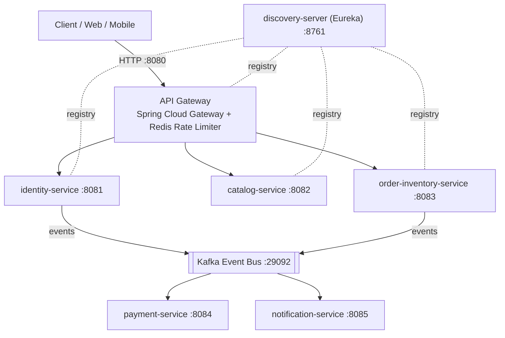

# omni-ecom

**English** | [Tiếng Việt](README.vi.md)

A personal learning project: a multi-service e-commerce platform (Microservices E-commerce Platform) built with **Java 21**, **Spring Boot 3.4.1**, **Spring Cloud**, and containerized with **Docker**.


## Table of Contents

- [1. Goals & Philosophy](#1-goals--philosophy)
- [2. Architecture](#2-architecture)
- [3. Modules](#3-modules)
- [4. Tech Stack](#4-tech-stack)
- [5. Quick Start](#5-quick-start)
- [6. Project Structure](#6-project-structure)

## 1. Goals & Philosophy

omni-ecom simulates and tackles real-world problems of a high-load e-commerce system with complex business logic:

- **Walking Skeleton**: build the infrastructure skeleton first (routing, configuration, logging, service discovery) so services are connected end to end from the start, before going deep into business logic and databases.
- **Twelve-Factor App**: strict separation of code and configuration; all infrastructure parameters (DB credentials, host, port) are managed through environment variables (`.env`).
- **Distributed Tracing**: `X-Correlation-Id` and MDC link a request from the Gateway through every domain service.
- **Data consistency**: the **Saga** pattern, **event-driven messaging (Kafka)** and **Idempotency Keys** protect sensitive transactions (ordering, stock deduction, payment).

## 2. Architecture

The system follows a **Maven Multi-Module** layout with clearly separated business boundaries (Bounded Contexts).



## 3. Modules

| Module | Port | Responsibility |
|---|---|---|
| `discovery-server` | 8761 | Eureka Server: central service registry, heartbeat monitoring. |
| `api-gateway` | 8080 | Single entry point (reverse proxy), dynamic load balancing (`lb://`), CORS, Redis rate limiting, assigns `X-Correlation-Id`. |
| `common` / `common-web` | – | Internal libraries: shared DTOs, `ApiResponse`, `CorrelationIdFilter` (MDC), `GlobalExceptionHandler`. |
| `identity-service` | 8081 | Accounts, Role/Permission authorization, JWT (short-lived Access Token, Refresh Token stored in DB), Argon2id password hashing. |
| `catalog-service` | 8082 | Category tree and product variants (MongoDB), full-text/facet search (Elasticsearch), caching (Redis). |
| `order-inventory-service` | 8083 | Cart, checkout, inventory (PostgreSQL), order orchestration via Saga. |
| `payment-service` | 8084 | Ledger-style payment transactions, signed Webhook verification from third parties. |
| `notification-service` | 8085 | Consumes Kafka events to send confirmation emails (Mailpit for local testing) and stores audit logs. |

## 4. Tech Stack

| Area | Technology |
|---|---|
| Language & Framework | Java 21, Spring Boot 3.4.1, Spring Cloud 2024.0.0 |
| Communication & Routing | Spring Cloud Gateway (WebFlux), Spring Cloud Netflix Eureka, OpenFeign |
| Databases | PostgreSQL 16 (relational), MongoDB 7 (document catalog/log) |
| Cache & Broker | Redis 7 (cache, rate limiting, idempotency), Apache Kafka 3.7 |
| Search & Mail testing | Elasticsearch 8.x, Mailpit |
| Docs & Testing | SpringDoc OpenAPI (Swagger UI), Spring Boot Actuator, Bash Scripting |

## 5. Quick Start

### Prerequisites

- JDK 21
- Maven 3.9+
- Docker & Docker Compose

### Install & run

```bash
# 1. Clone
git clone https://github.com/anhtuanp-99/omnichannel-ecommerce.git
cd omnichannel-ecommerce

# 2. Configure environment variables
cp .env.example .env        # adjust values as needed

# 3. Start infrastructure (PostgreSQL, MongoDB, Redis, Kafka, Elasticsearch, Mailpit)
docker compose up -d

# 4. Build all modules
mvn clean install -DskipTests

# 5. Run each service (recommended order: discovery-server -> api-gateway -> domain services)
mvn -pl discovery-server spring-boot:run
```

> Note: verify that the `mvn` commands above match how you actually run each service.

### Quick checks

- Eureka Dashboard: http://localhost:8761
- API Gateway: http://localhost:8080
- Health check: `http://localhost:<port>/actuator/health`

## 6. Project Structure

```text
omnichannel-ecommerce/
├── common/                     # Shared DTOs, ApiResponse
├── common-web/                 # CorrelationIdFilter, GlobalExceptionHandler
├── discovery-server/           # Eureka Server        (8761)
├── api-gateway/                # Spring Cloud Gateway (8080)
├── identity-service/           # Authentication & authorization (8081)
├── catalog-service/            # Categories & products          (8082)
├── order-inventory-service/    # Orders & inventory             (8083)
├── payment-service/            # Payments                       (8084)
├── notification-service/       # Notifications                  (8085)
├── docker/postgres/init/       # PostgreSQL init scripts
├── docs/                       # Documentation (SRS)
├── docker-compose.yml
├── .env.example
├── .gitignore
└── pom.xml                     # Parent POM (Maven Multi-Module)
```