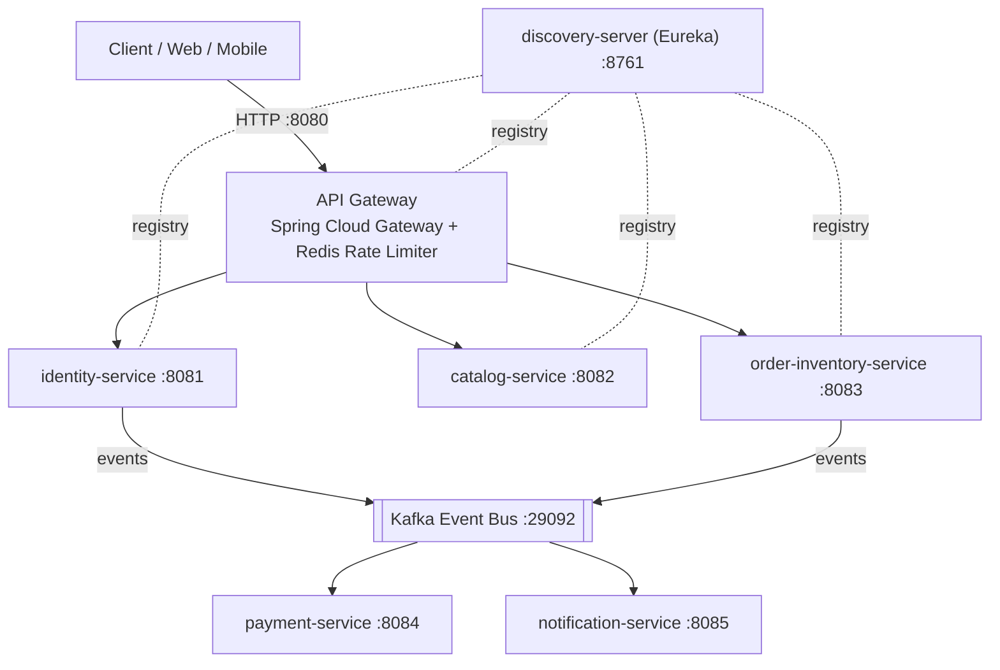

# omni-ecom

[English](README.md) | **Tiếng Việt**

Project cá nhân phục vụ mục đích học tập: hệ sinh thái thương mại điện tử đa dịch vụ (Microservices E-commerce Platform) xây dựng trên **Java 21**, **Spring Boot 3.4.1**, **Spring Cloud** và container hóa với **Docker**.


## Mục lục

- [1. Mục tiêu & Triết lý](#1-mục-tiêu--triết-lý)
- [2. Kiến trúc tổng thể](#2-kiến-trúc-tổng-thể)
- [3. Các phân hệ](#3-các-phân-hệ)
- [4. Công nghệ & Hạ tầng](#4-công-nghệ--hạ-tầng)
- [5. Bắt đầu nhanh](#5-bắt-đầu-nhanh)
- [6. Cấu trúc thư mục](#6-cấu-trúc-thư-mục)

## 1. Mục tiêu & Triết lý

omni-ecom mô phỏng và giải quyết các bài toán thực tế của một hệ thống thương mại điện tử chịu tải lớn, nghiệp vụ phức tạp:

- **Walking Skeleton**: hoàn thiện bộ khung hạ tầng (định tuyến, cấu hình, logging, service discovery) trước, để các dịch vụ kết nối thông suốt từ đầu, sau đó mới đi sâu vào logic nghiệp vụ và cơ sở dữ liệu.
- **Twelve-Factor App**: tách biệt mã nguồn và cấu hình; mọi tham số hạ tầng (DB credentials, host, port) quản lý qua biến môi trường (`.env`).
- **Distributed Tracing**: dùng `X-Correlation-Id` và MDC để xâu chuỗi request từ Gateway xuyên suốt các domain service.
- **Nhất quán dữ liệu**: áp dụng mô hình **Saga**, **Event-driven Messaging (Kafka)** và **Idempotency Key** cho các giao dịch nhạy cảm (đặt hàng, trừ kho, thanh toán).

## 2. Kiến trúc tổng thể

Hệ thống theo mô hình **Maven Multi-Module**, chia ranh giới nghiệp vụ (Bounded Context) rõ ràng.



## 3. Các phân hệ

| Module | Port | Vai trò |
|---|---|---|
| `discovery-server` | 8761 | Eureka Server: danh bạ dịch vụ tập trung, theo dõi heartbeat. |
| `api-gateway` | 8080 | Điểm vào duy nhất (Reverse Proxy), cân bằng tải (`lb://`), CORS, rate limit qua Redis, gán `X-Correlation-Id`. |
| `common` / `common-web` | – | Thư viện nội bộ: DTO dùng chung, `ApiResponse`, `CorrelationIdFilter` (MDC), `GlobalExceptionHandler`. |
| `identity-service` | 8081 | Tài khoản, phân quyền Role/Permission, JWT (Access Token ngắn hạn, Refresh Token lưu DB), mã hóa mật khẩu Argon2id. |
| `catalog-service` | 8082 | Cây danh mục & sản phẩm biến thể (MongoDB), tìm kiếm full-text/facet (Elasticsearch), cache (Redis). |
| `order-inventory-service` | 8083 | Giỏ hàng, checkout, tồn kho (PostgreSQL), điều phối đơn hàng theo Saga. |
| `payment-service` | 8084 | Giao dịch thanh toán dạng sổ cái (Ledger), xác thực Webhook chữ ký số từ bên thứ ba. |
| `notification-service` | 8085 | Nghe sự kiện Kafka để gửi email xác nhận (Mailpit khi test local) và lưu audit log. |

## 4. Công nghệ & Hạ tầng

| Lĩnh vực | Công nghệ |
|---|---|
| Ngôn ngữ & Framework | Java 21, Spring Boot 3.4.1, Spring Cloud 2024.0.0 |
| Giao tiếp & Định tuyến | Spring Cloud Gateway (WebFlux), Spring Cloud Netflix Eureka, OpenFeign |
| Cơ sở dữ liệu | PostgreSQL 16 (quan hệ), MongoDB 7 (Document Catalog/Log) |
| Cache & Broker | Redis 7 (Cache, Rate Limiting, Idempotency), Apache Kafka 3.7 |
| Tìm kiếm & Giả lập mail | Elasticsearch 8.x, Mailpit |
| Tài liệu & Kiểm thử | SpringDoc OpenAPI (Swagger UI), Spring Boot Actuator, Bash Scripting |

## 5. Bắt đầu nhanh

### Yêu cầu

- JDK 21
- Maven 3.9+
- Docker & Docker Compose

### Cài đặt & chạy

```bash
# 1. Clone
git clone https://github.com/anhtuanp-99/omnichannel-ecommerce.git
cd omnichannel-ecommerce

# 2. Cấu hình biến môi trường
cp .env.example .env        # chỉnh lại giá trị cho phù hợp

# 3. Khởi động hạ tầng (PostgreSQL, MongoDB, Redis, Kafka, Elasticsearch, Mailpit)
docker compose up -d

# 4. Build toàn bộ module
mvn clean install -DskipTests

# 5. Chạy từng service (thứ tự khuyến nghị: discovery-server -> api-gateway -> các domain service)
mvn -pl discovery-server spring-boot:run
```

> Lưu ý: kiểm tra lại các lệnh `mvn` ở trên cho khớp với cách bạn chạy từng service.

### Kiểm tra nhanh

- Eureka Dashboard: http://localhost:8761
- API Gateway: http://localhost:8080
- Health check: `http://localhost:<port>/actuator/health`

## 6. Cấu trúc thư mục

```text
omnichannel-ecommerce/
├── common/                     # DTO, ApiResponse dùng chung
├── common-web/                 # CorrelationIdFilter, GlobalExceptionHandler
├── discovery-server/           # Eureka Server        (8761)
├── api-gateway/                # Spring Cloud Gateway (8080)
├── identity-service/           # Xác thực & phân quyền (8081)
├── catalog-service/            # Danh mục & sản phẩm   (8082)
├── order-inventory-service/    # Đơn hàng & tồn kho    (8083)
├── payment-service/            # Thanh toán            (8084)
├── notification-service/       # Thông báo             (8085)
├── docker/postgres/init/       # Script khởi tạo PostgreSQL
├── docs/                       # Tài liệu (SRS)
├── docker-compose.yml
├── .env.example
├── .gitignore
└── pom.xml                     # Parent POM (Maven Multi-Module)
```