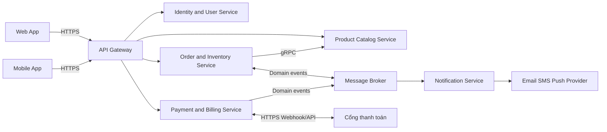
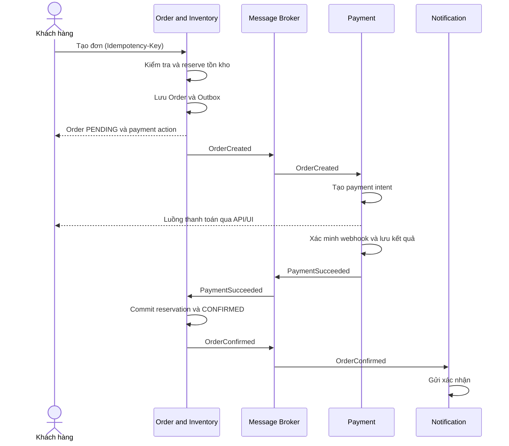

# ĐẶC TẢ YÊU CẦU PHẦN MỀM: Hệ thống Thương mại điện tử đa kênh theo kiến trúc Microservices

| Thuộc tính | Giá trị |
|---|---|
| Mã tài liệu | SRS-OMNI-ECOM-001 |
| Phiên bản | 1.0 |
| Trạng thái | Bản cơ sở phục vụ phân tích, thiết kế, phát triển và nghiệm thu |
| Tiêu chuẩn cấu trúc | IEEE 830-1998 |

> **Ghi chú chuyển đổi (không thuộc SRS gốc):** File này là bản Markdown của SRS gốc dạng PDF, giữ nguyên nội dung và mã yêu cầu. Hai hình vẽ trong PDF (sơ đồ ngữ cảnh ở mục 2.1 và sơ đồ tuần tự ở mục 4.7.1) được vẽ lại bằng Mermaid. Nội dung gốc đánh số ràng buộc `CON-01` đến `CON-06` rồi nhảy sang `CON-09`; mã `CON-07`, `CON-08` không tồn tại trong bản gốc và được giữ nguyên, không đánh số lại.
>
> **Quy ước từ khóa:** PHẢI = bắt buộc; NÊN = khuyến nghị; TBD = chưa quyết định, cần xác nhận (xem mục 10).

## Mục lục

1. [Giới thiệu](#1-giới-thiệu)
2. [Mô tả tổng thể](#2-mô-tả-tổng-thể)
3. [Yêu cầu giao diện ngoài](#3-yêu-cầu-giao-diện-ngoài)
4. [Yêu cầu chức năng cụ thể](#4-yêu-cầu-chức-năng-cụ-thể)
5. [Yêu cầu dữ liệu](#5-yêu-cầu-dữ-liệu)
6. [Yêu cầu phi chức năng](#6-yêu-cầu-phi-chức-năng)
7. [Quy tắc nghiệp vụ](#7-quy-tắc-nghiệp-vụ)
8. [Kịch bản sử dụng và tiêu chí nghiệm thu](#8-kịch-bản-sử-dụng-và-tiêu-chí-nghiệm-thu)
9. [Ma trận truy vết yêu cầu](#9-ma-trận-truy-vết-yêu-cầu)
10. [Các vấn đề cần quyết định](#10-các-vấn-đề-cần-quyết-định)
11. [Phụ lục A: Mẫu phản hồi API](#phụ-lục-a-mẫu-phản-hồi-api)
12. [Phụ lục B: Danh mục mã lỗi tối thiểu](#phụ-lục-b-danh-mục-mã-lỗi-tối-thiểu)
13. [Phụ lục C: Chiến lược kiểm thử tối thiểu](#phụ-lục-c-chiến-lược-kiểm-thử-tối-thiểu)
14. [Phụ lục D: Tiêu chí chất lượng của SRS](#phụ-lục-d-tiêu-chí-chất-lượng-của-srs)

---

## 1. Giới thiệu

### 1.1. Mục đích

Tài liệu này đặc tả đầy đủ các yêu cầu phần mềm cho Hệ thống Thương mại điện tử đa kênh theo kiến trúc Microservices, sau đây gọi là **Hệ thống**. Tài liệu là cơ sở thống nhất giữa chủ nhiệm sản phẩm, giảng viên, nhóm phát triển, nhóm kiểm thử, nhóm vận hành và các bên tích hợp về:

- Phạm vi và ranh giới của sản phẩm;
- Các tác nhân, quy trình nghiệp vụ và quy tắc xử lý;
- Yêu cầu chức năng, dữ liệu, giao diện và tích hợp;
- Yêu cầu chất lượng, bảo mật, hiệu năng, khả dụng và vận hành;
- Tiêu chí nghiệm thu và khả năng truy vết yêu cầu.

Tài liệu mô tả hệ thống cần làm gì và các ràng buộc phải tuân thủ. Thiết kế kỹ thuật chi tiết, mã nguồn, đặc tả OpenAPI và lược đồ cơ sở dữ liệu vật lý là các sản phẩm riêng được dẫn xuất từ SRS này.

### 1.2. Phạm vi sản phẩm

Hệ thống cung cấp nền tảng bán lẻ trực tuyến phục vụ khách hàng trên Web và ứng dụng di động thông qua một điểm truy cập API thống nhất. Phạm vi phiên bản 1.0 bao gồm:

- Đăng ký, đăng nhập, quản lý hồ sơ, địa chỉ và phân quyền người dùng;
- Quản trị danh mục, thương hiệu, sản phẩm, biến thể SKU, giá và hình ảnh;
- Duyệt, tìm kiếm, lọc và xem thông tin sản phẩm;
- Quản lý giỏ hàng và tạo đơn hàng;
- Kiểm tra, giữ chỗ, trừ và hoàn trả tồn kho an toàn khi có truy cập đồng thời;
- Thanh toán trực tuyến, nhận webhook, theo dõi giao dịch và hoàn tiền;
- Quản lý vòng đời đơn hàng;
- Gửi email, SMS hoặc thông báo đẩy theo sự kiện;
- Chịu tải trong kịch bản Flash Sale và duy trì tính đúng đắn của tồn kho.

Khái niệm "đa kênh" trong phiên bản này nghĩa là các kênh Web và Mobile dùng chung năng lực nghiệp vụ qua API Gateway. Đồng bộ điểm bán vật lý, sàn thương mại điện tử bên thứ ba hoặc mạng xã hội chưa thuộc phạm vi trừ khi được bổ sung bằng change request.

### 1.3. Đối tượng sử dụng tài liệu

| Đối tượng | Mục đích sử dụng |
|---|---|
| Chủ nhiệm sản phẩm/Giảng viên | Xác nhận phạm vi, ưu tiên và tiêu chí đánh giá |
| Business Analyst | Quản lý yêu cầu, quy tắc nghiệp vụ và truy vết |
| Kiến trúc sư/Trưởng nhóm kỹ thuật | Thiết kế kiến trúc, API, sự kiện và dữ liệu |
| Lập trình viên | Hiện thực chức năng theo mã yêu cầu |
| Kiểm thử viên | Xây dựng test plan, test case và tiêu chí nghiệm thu |
| Đội tích hợp | Tích hợp cổng thanh toán, email, SMS và push notification |

### 1.4. Định nghĩa, từ viết tắt và thuật ngữ

| Thuật ngữ | Định nghĩa |
|---|---|
| API Gateway | Điểm vào duy nhất, xác thực token, giới hạn lưu lượng và định tuyến yêu cầu |
| SKU | Đơn vị lưu kho đại diện cho một biến thể sản phẩm có thể bán |
| RBAC | Kiểm soát truy cập dựa trên vai trò |
| JWT | Token có chữ ký dùng để truyền thông tin định danh và quyền truy cập |
| Access Token | Token ngắn hạn dùng để truy cập tài nguyên bảo vệ |
| Refresh Token | Token dùng để xin cấp Access Token mới |
| Idempotency | Thuộc tính bảo đảm gửi lặp cùng một yêu cầu không tạo nhiều hiệu ứng nghiệp vụ |
| Saga | Mẫu điều phối giao dịch phân tán bằng các bước cục bộ và hành động bù |
| Outbox Pattern | Lưu thay đổi nghiệp vụ và sự kiện chờ phát trong cùng giao dịch cơ sở dữ liệu |
| Eventual Consistency | Các bản sao dữ liệu có thể lệch tạm thời nhưng cuối cùng hội tụ |
| Reservation | Bản ghi giữ một lượng tồn kho trong thời hạn nhất định cho đơn hàng |
| Overselling | Bán số lượng lớn hơn tồn kho khả dụng |
| Webhook | HTTP callback từ hệ thống bên ngoài về Hệ thống |
| PII | Dữ liệu nhận dạng cá nhân |
| DLQ | Hàng đợi chứa thông điệp xử lý thất bại sau số lần retry cho phép |
| Correlation ID | Mã liên kết log/trace xuyên suốt một yêu cầu hoặc quy trình phân tán |
| TBD | Nội dung chưa được quyết định, cần xác nhận |

### 1.5. Tài liệu tham chiếu

1. IEEE Std 830-1998, IEEE Recommended Practice for Software Requirements Specifications.
2. Đề tài 1, Hệ thống Thương mại điện tử Đa kênh chuẩn doanh nghiệp.
3. OWASP Application Security Verification Standard, phiên bản áp dụng tại thời điểm triển khai.
4. OpenAPI Specification, phiên bản được nhóm dự án lựa chọn.
5. Tài liệu kỹ thuật chính thức của cổng thanh toán được lựa chọn.

Nếu có mâu thuẫn, thứ tự ưu tiên là: change request đã phê duyệt, SRS đã phê duyệt, hợp đồng API, tài liệu thiết kế, sau cùng là tài liệu đề tài ban đầu.

### 1.6. Tổng quan tài liệu

Phần 2 mô tả bối cảnh, tác nhân, ràng buộc và giả định. Phần 3 đặc tả giao diện ngoài. Phần 4 mô tả các yêu cầu chức năng. Phần 5 trình bày yêu cầu dữ liệu. Phần 6 quy định các thuộc tính chất lượng. Phần 7 nêu quy tắc nghiệp vụ. Phần 8 mô tả tiêu chí nghiệm thu và phần 9 cung cấp ma trận truy vết.

---

## 2. Mô tả tổng thể

### 2.1. Bối cảnh sản phẩm

Hệ thống là một nền tảng phân tán, trong đó mỗi dịch vụ sở hữu miền nghiệp vụ và kho dữ liệu riêng. Client không truy cập trực tiếp các dịch vụ nội bộ mà đi qua API Gateway. Giao tiếp đồng bộ dùng HTTPS/REST hoặc gRPC; giao tiếp bất đồng bộ dùng message broker. Không dịch vụ nào được phép truy vấn trực tiếp cơ sở dữ liệu thuộc dịch vụ khác.



#### 2.1.1. Phân rã dịch vụ

| Thành phần | Trách nhiệm chính | Kho dữ liệu dự kiến |
|---|---|---|
| API Gateway | Điểm vào, xác thực token, rate limiting, routing, correlation ID | Cấu hình/Redis nếu cần |
| Identity and User Service | Tài khoản, hồ sơ, địa chỉ, RBAC, token | PostgreSQL hoặc MySQL |
| Product Catalog Service | Danh mục, thương hiệu, sản phẩm, SKU, hình ảnh, tìm kiếm | MongoDB và Elasticsearch |
| Order and Inventory Service | Giỏ hàng, đơn hàng, trạng thái, tồn kho, reservation | PostgreSQL và Redis |
| Payment and Billing Service | Payment intent, webhook, hoàn tiền, đối soát | PostgreSQL |
| Notification Service | Tiêu thụ sự kiện, gửi thông báo, lưu nhật ký | MongoDB/Redis theo thiết kế |
| Message Broker | Truyền sự kiện bền vững và tách rời dịch vụ | RabbitMQ hoặc Kafka |

### 2.2. Chức năng sản phẩm ở mức cao

1. Quản lý định danh, phiên đăng nhập và quyền truy cập.
2. Quản lý hồ sơ khách hàng và địa chỉ giao hàng.
3. Quản lý catalog và chỉ mục tìm kiếm.
4. Cho phép khách hàng duyệt, tìm kiếm và chọn SKU.
5. Quản lý giỏ hàng theo khách hàng.
6. Tạo đơn và chụp snapshot hàng hóa tại thời điểm mua.
7. Giữ và cập nhật tồn kho không oversell trong tải đồng thời cao.
8. Khởi tạo, xác nhận và hoàn tiền giao dịch thanh toán.
9. Điều phối quy trình phân tán bằng sự kiện và hành động bù.
10. Thông báo các thay đổi quan trọng cho khách hàng.
11. Cho phép nhân viên quản trị sản phẩm, kho và đơn hàng.

### 2.3. Nhóm người dùng và đặc điểm

| Tác nhân | Mô tả | Quyền chính |
|---|---|---|
| Khách vãng lai | Người chưa đăng nhập | Xem, tìm kiếm sản phẩm; đăng ký; đăng nhập |
| Khách hàng | Người mua đã xác thực | Quản lý hồ sơ, giỏ hàng, đặt hàng, thanh toán, theo dõi và hủy đơn hợp lệ |
| Nhân viên catalog | Quản trị nội dung bán hàng | CRUD danh mục, thương hiệu, sản phẩm, SKU, giá, hình ảnh |
| Nhân viên kho | Quản lý số lượng tồn | Nhập/điều chỉnh tồn kho, xem reservation và lịch sử biến động |
| Nhân viên vận hành đơn | Xử lý đơn | Xác nhận, chuyển trạng thái, xem lịch sử đơn |
| Nhân viên tài chính | Theo dõi giao dịch | Xem giao dịch, yêu cầu hoàn tiền, đối soát |
| Quản trị viên | Quản trị toàn hệ thống | Quản lý vai trò, quyền và các chức năng quản trị |
| Hệ thống cổng thanh toán | Tác nhân máy | Nhận yêu cầu thanh toán và gửi webhook |
| Nhà cung cấp thông báo | Tác nhân máy | Nhận yêu cầu gửi email, SMS hoặc push |

### 2.4. Môi trường vận hành

- Client Web trên các phiên bản ổn định còn được hỗ trợ của Chrome, Edge, Firefox và Safari.
- Client Mobile trên Android/iOS; phạm vi phiên bản hệ điều hành là TBD.
- Các ứng dụng khách giao tiếp với hệ thống qua HTTPS.
- PostgreSQL/MySQL, MongoDB, Elasticsearch, Redis và RabbitMQ/Kafka được lựa chọn theo quyết định kiến trúc đã phê duyệt.

### 2.5. Ràng buộc thiết kế

- **CON-01:** Hệ thống PHẢI được phân tách thành tối thiểu bốn microservice có thể build và chạy độc lập.
- **CON-02:** Mỗi dịch vụ PHẢI sở hữu dữ liệu của mình; cấm truy vấn chéo trực tiếp giữa các database.
- **CON-03:** API công khai PHẢI đi qua API Gateway và dùng HTTPS.
- **CON-04:** Ít nhất một luồng nghiệp vụ PHẢI sử dụng message broker theo mô hình bất đồng bộ.
- **CON-05:** Quy trình đặt hàng–tồn kho–thanh toán PHẢI xử lý giao dịch phân tán bằng Saga và hành động bù.
- **CON-06:** Dịch vụ phát domain event PHẢI dùng Transactional Outbox hoặc cơ chế tương đương để tránh mất sự kiện.
- **CON-09:** Bí mật PHẢI được quản lý bằng cơ chế bảo vệ phù hợp và không được ghi cứng trong mã nguồn.

### 2.6. Giả định và phụ thuộc

- **A-01:** Khách hàng phải đăng nhập trước khi checkout.
- **A-02:** Phiên bản 1.0 hỗ trợ một loại tiền tệ mặc định là VND; hỗ trợ đa tiền tệ là ngoài phạm vi.
- **A-03:** Phí vận chuyển và thuế được cung cấp bởi cấu hình/quy tắc nội bộ đơn giản; tích hợp hãng vận chuyển và máy tính thuế chuyên dụng là TBD.
- **A-04:** Một cổng thanh toán sandbox sẽ được chọn trong VNPay, MoMo, ZaloPay hoặc Stripe cho bản demo.
- **A-05:** Email là kênh thông báo bắt buộc; SMS và push phụ thuộc nhà cung cấp và cấu hình.
- **A-06:** Tính nhất quán mạnh áp dụng trong ranh giới một dịch vụ; giữa các dịch vụ chấp nhận nhất quán cuối cùng có kiểm soát.
- **A-07:** Sản phẩm vật lý và quy trình giao hàng cơ bản là trọng tâm; sản phẩm số, subscription, marketplace nhiều người bán ngoài phạm vi.
- **A-08:** Thời gian giữ kho mặc định là 15 phút nhưng PHẢI cấu hình được; giá trị cuối cùng là TBD.

### 2.7. Ngoài phạm vi phiên bản 1.0

- Quản lý cửa hàng vật lý/POS và chuyển kho đa địa điểm nâng cao;
- Đồng bộ listing với sàn thương mại điện tử hoặc mạng xã hội;
- Chương trình khách hàng thân thiết, voucher, coupon và promotion engine phức tạp;
- Marketplace nhiều nhà bán, chia hoa hồng và thanh toán cho nhà bán;
- Đấu giá, subscription, sản phẩm số;
- Hệ thống quản lý vận tải hoặc tối ưu tuyến giao hàng;
- AI recommendation, dynamic pricing và phân tích dữ liệu nâng cao;
- Đa ngôn ngữ, đa tiền tệ và đa quốc gia;
- Quy trình trả hàng sau giao hàng, trừ phần hoàn tiền cơ bản được mô tả tại mục thanh toán.

---

## 3. Yêu cầu giao diện ngoài

### 3.1. Giao diện người dùng

#### 3.1.1. Giao diện khách hàng

- **UI-01:** Web/Mobile PHẢI cung cấp các màn hình đăng ký, đăng nhập, quên/đặt lại mật khẩu, hồ sơ và sổ địa chỉ.
- **UI-02:** Giao diện catalog PHẢI hỗ trợ danh sách sản phẩm, tìm kiếm, lọc, sắp xếp, phân trang và trang chi tiết sản phẩm/SKU.
- **UI-03:** Giao diện giỏ hàng PHẢI hiển thị SKU, số lượng, đơn giá, thành tiền, tạm tính và cảnh báo khi sản phẩm không còn hợp lệ hoặc không đủ tồn.
- **UI-04:** Checkout PHẢI cho phép xác nhận địa chỉ, thông tin liên hệ, các khoản tiền, phương thức thanh toán và nội dung đơn trước khi đặt.
- **UI-05:** Trang kết quả thanh toán PHẢI phân biệt trạng thái đang xử lý, thành công, thất bại và hết hạn; không được coi redirect phía client là bằng chứng thanh toán cuối cùng.
- **UI-06:** Khách hàng PHẢI xem được danh sách đơn, chi tiết đơn, dòng thời gian trạng thái và giao dịch liên quan.
- **UI-07:** Hành động không thể hoàn tác hoặc có ảnh hưởng tài chính PHẢI có bước xác nhận.
- **UI-08:** Thông báo lỗi PHẢI dễ hiểu, không làm lộ stack trace, thông tin hạ tầng hoặc bí mật.
- **UI-09:** Giao diện NÊN đáp ứng WCAG 2.1 mức AA cho các luồng chính.
- **UI-10:** Ngày giờ hiển thị theo múi giờ người dùng hoặc mặc định Asia/Ho_Chi_Minh; dữ liệu trao đổi giữa hệ thống dùng ISO 8601.

#### 3.1.2. Giao diện quản trị

- **UI-ADM-01:** Giao diện quản trị PHẢI yêu cầu tài khoản có vai trò/quyền phù hợp.
- **UI-ADM-02:** Danh sách dữ liệu PHẢI hỗ trợ tìm kiếm, lọc, sắp xếp, phân trang và chỉ báo trạng thái.
- **UI-ADM-03:** Biểu mẫu PHẢI kiểm tra dữ liệu phía client và server, đồng thời chỉ rõ trường không hợp lệ.
- **UI-ADM-04:** Các thay đổi sản phẩm, giá, tồn kho, quyền và hoàn tiền PHẢI hiển thị kết quả rõ ràng và được ghi audit.

### 3.2. Giao diện phần cứng

Hệ thống không yêu cầu thiết bị phần cứng chuyên dụng và không giao tiếp trực tiếp với thiết bị ngoại vi.

### 3.3. Giao diện phần mềm

| Hệ thống/Thành phần | Hướng giao tiếp | Giao thức/Định dạng | Yêu cầu chính |
|---|---|---|---|
| Web/Mobile ↔ API Gateway | Hai chiều | HTTPS, JSON | JWT, versioning, rate limit |
| Gateway ↔ Microservices | Hai chiều | HTTP/REST hoặc gRPC | Timeout, correlation ID, retry có kiểm soát |
| Order ↔ Product Catalog | Hai chiều | gRPC/HTTP2 dự kiến | Tra cứu SKU; mục tiêu nội bộ dưới 5 ms trong điều kiện chuẩn |
| Services ↔ Broker | Hai chiều | AMQP/Kafka protocol | Durable message, ack, retry, DLQ |
| Payment ↔ Payment Provider | Hai chiều | HTTPS/JSON/form tùy provider | Chữ ký, idempotency, webhook |
| Notification ↔ Provider | Đi | HTTPS/SMTP/provider SDK | Retry, timeout, tracking ID |

### 3.4. Giao diện truyền thông

- **COM-01:** Giao tiếp công khai PHẢI dùng TLS 1.2 trở lên; TLS 1.3 được ưu tiên.
- **COM-02:** API JSON PHẢI dùng UTF-8 và media type phù hợp.
- **COM-03:** API PHẢI được version hóa, tối thiểu theo đường dẫn hoặc header.
- **COM-04:** Mọi phản hồi API PHẢI có mã HTTP đúng ngữ nghĩa và cấu trúc lỗi thống nhất gồm tối thiểu `code`, `message`, `correlationId`; `details` chỉ dùng khi an toàn.
- **COM-05:** Mỗi request PHẢI có hoặc được cấp `correlationId`, sau đó truyền qua các lời gọi đồng bộ và metadata sự kiện.
- **COM-06:** Client PHẢI đặt timeout; retry chỉ áp dụng với lỗi tạm thời và thao tác an toàn/idempotent, dùng exponential backoff có jitter.
- **COM-07:** Event PHẢI có tối thiểu `eventId`, `eventType`, `eventVersion`, `occurredAt`, `correlationId`, `producer` và `payload`.
- **COM-08:** Consumer PHẢI xử lý trùng lặp an toàn theo `eventId` hoặc business key.
- **COM-09:** Thông điệp thất bại sau ngưỡng retry PHẢI chuyển vào DLQ và tạo cảnh báo vận hành.

---

## 4. Yêu cầu chức năng cụ thể

### 4.1. Quản lý định danh và người dùng

#### 4.1.1. Đăng ký và kích hoạt tài khoản

- **FR-IAM-001:** Hệ thống PHẢI cho phép khách vãng lai đăng ký bằng email hoặc số điện thoại theo cấu hình.
- **FR-IAM-002:** Hệ thống PHẢI kiểm tra định dạng, tính bắt buộc và tính duy nhất của định danh đăng nhập đã chuẩn hóa.
- **FR-IAM-003:** Hệ thống PHẢI áp dụng chính sách mật khẩu được cấu hình và không lưu mật khẩu dạng rõ hoặc có thể giải mã.
- **FR-IAM-004:** Hệ thống PHẢI tạo tài khoản ở trạng thái phù hợp và gửi yêu cầu xác minh nếu chính sách bật xác minh.
- **FR-IAM-005:** Token xác minh PHẢI có thời hạn, dùng một lần và không lưu dạng rõ.
- **FR-IAM-006:** Hệ thống PHẢI ghi audit cho việc đăng ký, kích hoạt và thay đổi định danh quan trọng.

#### 4.1.2. Xác thực và phiên

- **FR-IAM-007:** Người dùng PHẢI có thể đăng nhập bằng thông tin hợp lệ và nhận Access Token cùng Refresh Token.
- **FR-IAM-008:** Hệ thống PHẢI từ chối thông tin xác thực sai bằng thông báo không tiết lộ tài khoản có tồn tại hay không.
- **FR-IAM-009:** Hệ thống PHẢI giới hạn tốc độ và có cơ chế giảm thiểu brute force đối với đăng nhập, refresh và quên mật khẩu.
- **FR-IAM-010:** Access Token PHẢI có thời hạn ngắn và chứa tối thiểu subject, thời điểm cấp, hết hạn và thông tin quyền/role cần thiết.
- **FR-IAM-011:** Refresh Token PHẢI có thể bị thu hồi, xoay vòng khi sử dụng và phát hiện reuse theo chính sách.
- **FR-IAM-012:** Người dùng PHẢI có thể đăng xuất phiên hiện tại; quản trị viên hoặc người dùng PHẢI có thể thu hồi toàn bộ phiên khi có rủi ro.
- **FR-IAM-013:** Hệ thống PHẢI hỗ trợ quy trình quên và đặt lại mật khẩu bằng token có thời hạn, dùng một lần.

#### 4.1.3. Hồ sơ, địa chỉ và phân quyền

- **FR-IAM-014:** Khách hàng PHẢI xem và cập nhật họ tên, số điện thoại và các thuộc tính hồ sơ được phép.
- **FR-IAM-015:** Khách hàng PHẢI có thể thêm, sửa, xóa và chọn địa chỉ mặc định.
- **FR-IAM-016:** Hệ thống PHẢI xác thực cấu trúc địa chỉ và từ chối thao tác với địa chỉ không thuộc người dùng.
- **FR-IAM-017:** Hệ thống PHẢI hỗ trợ RBAC với vai trò tối thiểu Customer, CatalogStaff, InventoryStaff, OrderStaff, FinanceStaff và Administrator.
- **FR-IAM-018:** Mỗi endpoint bảo vệ PHẢI kiểm tra cả xác thực và quyền truy cập phía server.
- **FR-IAM-019:** Chỉ người có quyền quản trị IAM mới được gán/thu hồi vai trò; mọi thay đổi PHẢI được audit.

### 4.2. Quản lý catalog sản phẩm

#### 4.2.1. Danh mục và thương hiệu

- **FR-CAT-001:** Nhân viên có quyền PHẢI tạo, xem, sửa, kích hoạt/ngừng kích hoạt danh mục.
- **FR-CAT-002:** Hệ thống PHẢI hỗ trợ cấu trúc danh mục phân cấp và ngăn chu trình trong cây danh mục.
- **FR-CAT-003:** Nhân viên có quyền PHẢI tạo, xem, sửa, kích hoạt/ngừng kích hoạt thương hiệu.
- **FR-CAT-004:** Không được xóa cứng danh mục/thương hiệu đang được sản phẩm tham chiếu; Hệ thống PHẢI từ chối hoặc chuyển sang ngừng hoạt động theo quy tắc được chọn.

#### 4.2.2. Sản phẩm, SKU, giá và hình ảnh

- **FR-CAT-005:** Nhân viên catalog PHẢI tạo và cập nhật sản phẩm với tên, mô tả, danh mục, thương hiệu, trạng thái và metadata cần thiết.
- **FR-CAT-006:** Mỗi sản phẩm PHẢI có một hoặc nhiều SKU; mã SKU PHẢI duy nhất toàn hệ thống.
- **FR-CAT-007:** Mỗi SKU PHẢI có tập thuộc tính biến thể, giá bán, đơn vị tiền tệ và trạng thái bán.
- **FR-CAT-008:** Giá PHẢI là số không âm, lưu bằng kiểu số thập phân hoặc đơn vị nhỏ nhất; không dùng floating-point nhị phân cho tính tiền.
- **FR-CAT-009:** Hệ thống PHẢI cho phép gắn nhiều hình ảnh cho sản phẩm/SKU, chỉ định ảnh chính và kiểm tra loại/kích thước tệp theo cấu hình.
- **FR-CAT-010:** Sản phẩm chỉ xuất hiện trên kênh bán khi sản phẩm và SKU tương ứng đều ở trạng thái được phép công bố.
- **FR-CAT-011:** Mọi thay đổi catalog quan trọng PHẢI ghi người thay đổi, thời điểm và giá trị trước/sau hoặc thông tin tương đương.
- **FR-CAT-012:** Khi sản phẩm/SKU/giá thay đổi, Hệ thống PHẢI cập nhật chỉ mục tìm kiếm theo cơ chế có thể retry và quan sát được.

#### 4.2.3. Duyệt và tìm kiếm

- **FR-CAT-013:** Người dùng PHẢI xem được danh sách sản phẩm đang công bố với phân trang ổn định.
- **FR-CAT-014:** Người dùng PHẢI tìm kiếm full-text theo tối thiểu tên, mô tả, mã SKU, thương hiệu và danh mục phù hợp.
- **FR-CAT-015:** Người dùng PHẢI lọc theo danh mục, thương hiệu, khoảng giá, trạng thái còn hàng và thuộc tính biến thể khả dụng.
- **FR-CAT-016:** Người dùng PHẢI sắp xếp theo mức liên quan, giá và thời điểm cập nhật/tạo theo thiết kế UI.
- **FR-CAT-017:** Trang chi tiết PHẢI trả về thông tin sản phẩm, các SKU đang bán, giá hiện hành, hình ảnh và chỉ báo còn hàng.
- **FR-CAT-018:** Nếu chỉ mục tìm kiếm chưa đồng bộ, nguồn dữ liệu catalog vẫn là nguồn sự thật; hệ thống PHẢI có cơ chế tái lập chỉ mục.

### 4.3. Quản lý giỏ hàng

- **FR-CART-001:** Khách hàng đã xác thực PHẢI có một giỏ hàng hoạt động trên các kênh dùng chung tài khoản.
- **FR-CART-002:** Khách hàng PHẢI thêm SKU đang bán vào giỏ với số lượng nguyên dương.
- **FR-CART-003:** Khách hàng PHẢI cập nhật số lượng hoặc xóa dòng hàng khỏi giỏ.
- **FR-CART-004:** Hệ thống PHẢI từ chối số lượng vượt giới hạn đặt hàng theo SKU hoặc cấu hình.
- **FR-CART-005:** Việc thêm vào giỏ KHÔNG đồng nghĩa giữ tồn kho trừ khi chính sách được thay đổi rõ ràng.
- **FR-CART-006:** Khi hiển thị giỏ, Hệ thống PHẢI đánh giá lại trạng thái bán, giá hiện hành và khả năng đáp ứng tồn kho.
- **FR-CART-007:** Hệ thống PHẢI thông báo các thay đổi về giá, trạng thái hoặc tồn kho trước khi checkout.
- **FR-CART-008:** Tổng tiền hiển thị trong giỏ là ước tính; tổng tiền được chốt trong đơn theo quy tắc tại thời điểm tạo đơn.

### 4.4. Quản lý tồn kho

#### 4.4.1. Số lượng và biến động tồn

- **FR-INV-001:** Hệ thống PHẢI quản lý tồn kho theo SKU và địa điểm kho logic; phiên bản tối thiểu có một kho mặc định.
- **FR-INV-002:** Với mỗi SKU/kho, Hệ thống PHẢI quản lý tối thiểu `onHand`, `reserved` và `available`, trong đó `available = onHand - reserved` theo mô hình được phê duyệt.
- **FR-INV-003:** Nhân viên kho có quyền PHẢI có thể nhập hoặc điều chỉnh tồn với lý do bắt buộc.
- **FR-INV-004:** Mọi biến động tồn PHẢI tạo bản ghi ledger bất biến gồm SKU, kho, loại biến động, số lượng, tham chiếu nghiệp vụ, người/hệ thống thực hiện và thời điểm.
- **FR-INV-005:** Hệ thống PHẢI từ chối thao tác làm `onHand`, `reserved` hoặc `available` âm, trừ cơ chế điều chỉnh đặc biệt đã phê duyệt và audit.

#### 4.4.2. Giữ và giải phóng tồn

- **FR-INV-006:** Khi tạo đơn, Hệ thống PHẢI kiểm tra và giữ tồn cho toàn bộ dòng hàng như một thao tác nghiệp vụ nhất quán.
- **FR-INV-007:** Reservation PHẢI có mã duy nhất, order ID, SKU, số lượng, trạng thái và thời điểm hết hạn.
- **FR-INV-008:** Yêu cầu giữ tồn lặp với cùng khóa idempotency/order ID PHẢI trả cùng kết quả logic và không giữ kho hai lần.
- **FR-INV-009:** Hệ thống PHẢI bảo đảm không oversell khi nhiều yêu cầu đồng thời mua cùng SKU bằng atomic conditional update, database lock hoặc distributed lock đã kiểm chứng.
- **FR-INV-010:** Nếu không đủ tồn ở bất kỳ dòng nào, Hệ thống PHẢI không hoàn tất reservation một phần, hoặc PHẢI bù toàn bộ phần đã giữ trước khi trả thất bại.
- **FR-INV-011:** Reservation chưa được thanh toán PHẢI tự động hết hạn sau thời gian cấu hình và giải phóng đúng số lượng.
- **FR-INV-012:** Khi thanh toán được xác nhận, Hệ thống PHẢI chuyển reservation thành trừ tồn chính thức đúng một lần.
- **FR-INV-013:** Khi đơn bị hủy trước khi trừ tồn, reservation PHẢI được giải phóng đúng một lần.
- **FR-INV-014:** Khi cần bù sau khi đã trừ tồn, Hệ thống PHẢI tạo biến động hoàn tồn có tham chiếu tới đơn/giao dịch gốc.
- **FR-INV-015:** Job xử lý reservation hết hạn PHẢI an toàn khi chạy lặp hoặc chạy đồng thời trên nhiều instance.

### 4.5. Quản lý đơn hàng

#### 4.5.1. Tạo đơn

- **FR-ORD-001:** Chỉ khách hàng đã xác thực mới được tạo đơn trong phiên bản 1.0.
- **FR-ORD-002:** Yêu cầu tạo đơn PHẢI có `Idempotency-Key`; gửi lặp cùng khóa và cùng payload PHẢI không tạo thêm đơn.
- **FR-ORD-003:** Hệ thống PHẢI kiểm tra quyền sở hữu địa chỉ, giỏ hàng không rỗng, trạng thái SKU, giá và tồn kho trước khi chấp nhận đơn.
- **FR-ORD-004:** Đơn hàng PHẢI lưu snapshot tối thiểu gồm mã/tên SKU, tên sản phẩm, thuộc tính biến thể, đơn giá, số lượng, giảm giá nếu có và thành tiền tại thời điểm mua.
- **FR-ORD-005:** Đơn PHẢI lưu snapshot địa chỉ giao hàng và thông tin liên hệ để thay đổi hồ sơ sau đó không làm biến đổi đơn lịch sử.
- **FR-ORD-006:** Hệ thống PHẢI tính tổng tiền xác định, bao gồm tạm tính, giảm giá, thuế, phí vận chuyển và tổng thanh toán; phiên bản 1.0 có thể đặt các khoản chưa áp dụng bằng 0.
- **FR-ORD-007:** Hệ thống PHẢI tạo mã đơn duy nhất, không chứa PII và phù hợp để hỗ trợ tra cứu.
- **FR-ORD-008:** Sau khi lưu đơn và reservation thành công, Order Service PHẢI phát `OrderCreated` thông qua Outbox.
- **FR-ORD-009:** Nếu giữ kho thất bại, đơn PHẢI chuyển sang trạng thái thất bại/hủy phù hợp và không được yêu cầu thanh toán.

#### 4.5.2. Trạng thái và vòng đời đơn

Các trạng thái nghiệp vụ tối thiểu:

| Trạng thái | Ý nghĩa |
|---|---|
| PENDING | Đơn đã tạo, đang chờ hoàn tất bước tiền xử lý/thanh toán |
| CONFIRMED | Thanh toán hoặc điều kiện xác nhận đã hoàn tất |
| SHIPPING | Đơn đã bàn giao để giao hàng |
| COMPLETED | Đơn đã hoàn tất |
| CANCELLED | Đơn đã hủy |

- **FR-ORD-010:** Hệ thống PHẢI kiểm soát chuyển trạng thái theo state machine, không cho phép bước chuyển không hợp lệ.
- **FR-ORD-011:** Mỗi chuyển trạng thái PHẢI ghi trạng thái cũ, trạng thái mới, lý do, tác nhân và thời điểm.
- **FR-ORD-012:** Khách hàng PHẢI xem được các đơn thuộc chính mình và không được truy cập đơn của người khác.
- **FR-ORD-013:** Nhân viên vận hành có quyền PHẢI tìm kiếm và lọc đơn theo mã, khách hàng, trạng thái và khoảng thời gian.
- **FR-ORD-014:** Nhân viên vận hành PHẢI có thể chuyển đơn qua các trạng thái hợp lệ theo quyền.
- **FR-ORD-015:** Mọi thay đổi trạng thái thành công PHẢI phát domain event tương ứng thông qua Outbox.

#### 4.5.3. Hủy đơn

- **FR-ORD-016:** Khách hàng PHẢI có thể yêu cầu hủy khi đơn ở trạng thái cho phép; ma trận trạng thái cuối cùng là TBD.
- **FR-ORD-017:** Hệ thống PHẢI lưu lý do hủy và tác nhân yêu cầu hủy.
- **FR-ORD-018:** Hủy đơn PHẢI kích hoạt giải phóng/hoàn tồn và yêu cầu hoàn tiền nếu thanh toán đã thành công.
- **FR-ORD-019:** Đơn chỉ chuyển CANCELLED khi các bước bắt buộc của Saga hủy đạt trạng thái được định nghĩa; các bước bất đồng bộ PHẢI được thể hiện là đang xử lý.
- **FR-ORD-020:** Yêu cầu hủy lặp PHẢI idempotent.

### 4.6. Thanh toán và lập hóa đơn

#### 4.6.1. Khởi tạo và xác nhận thanh toán

- **FR-PAY-001:** Payment Service PHẢI tạo một payment intent gắn với đơn, số tiền, tiền tệ, provider và trạng thái.
- **FR-PAY-002:** Số tiền thanh toán PHẢI lấy từ snapshot tổng tiền của đơn, không tin cậy số tiền do client gửi.
- **FR-PAY-003:** Mỗi yêu cầu khởi tạo thanh toán PHẢI idempotent theo đơn và lần thanh toán hợp lệ.
- **FR-PAY-004:** Hệ thống PHẢI hỗ trợ ít nhất một cổng thanh toán trong môi trường sandbox và cô lập adapter theo provider.
- **FR-PAY-005:** Hệ thống PHẢI lưu mã tham chiếu phía provider, không lưu dữ liệu thẻ nhạy cảm nếu không cần thiết.
- **FR-PAY-006:** Hệ thống PHẢI xử lý các trạng thái tối thiểu PENDING, SUCCEEDED, FAILED, EXPIRED, REFUND_PENDING, REFUNDED, PARTIALLY_REFUNDED nếu provider hỗ trợ.

#### 4.6.2. Webhook

- **FR-PAY-007:** Endpoint webhook PHẢI xác minh chữ ký/xác thực theo tài liệu provider trước khi xử lý.
- **FR-PAY-008:** Webhook PHẢI kiểm tra timestamp/replay protection nếu provider hỗ trợ.
- **FR-PAY-009:** Webhook trùng PHẢI được xử lý idempotent và không phát sinh ghi nhận thanh toán hoặc event trùng về mặt nghiệp vụ.
- **FR-PAY-010:** Hệ thống PHẢI đối chiếu order reference, payment reference, số tiền và tiền tệ trước khi xác nhận thành công.
- **FR-PAY-011:** Trạng thái cuối cùng từ webhook/provider là nguồn xác nhận thanh toán; redirect phía client không được tự quyết định thanh toán thành công.
- **FR-PAY-012:** Sau khi ghi nhận kết quả, Payment Service PHẢI phát event thích hợp qua Outbox.
- **FR-PAY-013:** Webhook hợp lệ PHẢI được phản hồi trong thời gian phù hợp với provider; xử lý dài PHẢI chuyển sang bất đồng bộ.

#### 4.6.3. Hoàn tiền và đối soát

- **FR-PAY-014:** Nhân viên tài chính có quyền PHẢI có thể yêu cầu hoàn tiền toàn phần hoặc một phần nếu provider và chính sách hỗ trợ.
- **FR-PAY-015:** Tổng tiền hoàn lũy kế PHẢI không vượt quá số tiền đã thanh toán thành công.
- **FR-PAY-016:** Yêu cầu hoàn tiền PHẢI idempotent, có lý do, người yêu cầu và audit trail.
- **FR-PAY-017:** Kết quả hoàn tiền PHẢI cập nhật trạng thái giao dịch và phát event cho Order/Notification.
- **FR-PAY-018:** Hệ thống PHẢI có tác vụ đối soát định kỳ giữa giao dịch nội bộ và dữ liệu provider, tạo báo cáo sai lệch để xử lý.
- **FR-PAY-019:** Không được sửa/xóa trực tiếp bản ghi giao dịch tài chính đã hoàn tất; điều chỉnh phải qua giao dịch bù có liên kết.

### 4.7. Điều phối Saga và xử lý sự kiện

#### 4.7.1. Luồng đặt hàng chuẩn



- **FR-SAGA-001:** Mỗi Saga instance PHẢI có định danh, trạng thái, correlation ID và lịch sử bước xử lý.
- **FR-SAGA-002:** Luồng thành công PHẢI bảo đảm đơn, tồn kho và thanh toán hội tụ về trạng thái nhất quán.
- **FR-SAGA-003:** Khi thanh toán thất bại/hết hạn, Hệ thống PHẢI giải phóng reservation và chuyển đơn sang trạng thái phù hợp.
- **FR-SAGA-004:** Khi xác nhận đơn thất bại sau thanh toán thành công và không thể phục hồi trong ngưỡng retry, Hệ thống PHẢI khởi tạo hoàn tiền hoặc đưa vào hàng đợi can thiệp thủ công có cảnh báo.
- **FR-SAGA-005:** Hành động bù PHẢI idempotent và có audit trail.
- **FR-SAGA-006:** Dịch vụ không sẵn sàng tạm thời PHẢI được retry theo chính sách; lỗi nghiệp vụ không retry vô hạn.
- **FR-SAGA-007:** Sự kiện đến sai thứ tự PHẢI được từ chối, trì hoãn hoặc hợp nhất an toàn dựa trên version/state transition.
- **FR-SAGA-008:** Outbox publisher PHẢI đánh dấu sự kiện đã phát theo cách an toàn và có thể phát lại khi broker lỗi.
- **FR-SAGA-009:** Consumer PHẢI lưu bằng chứng đã xử lý hoặc áp dụng thao tác idempotent để chịu được at-least-once delivery.
- **FR-SAGA-010:** Nhân viên vận hành PHẢI có khả năng quan sát Saga lỗi, retry hoặc kích hoạt xử lý bù theo quyền; thao tác thủ công PHẢI audit.

### 4.8. Dịch vụ thông báo

- **FR-NOT-001:** Notification Service PHẢI tiêu thụ các event được cấu hình như đăng ký tài khoản, tạo đơn, xác nhận thanh toán, đổi trạng thái đơn, hủy và hoàn tiền.
- **FR-NOT-002:** Hệ thống PHẢI hỗ trợ email; SMS và push là kênh tùy cấu hình.
- **FR-NOT-003:** Template PHẢI được định danh theo loại thông báo, kênh, ngôn ngữ và phiên bản nếu áp dụng.
- **FR-NOT-004:** Nội dung thông báo PHẢI lấy từ dữ liệu event/snapshot cần thiết, không truy vấn trực tiếp database của dịch vụ khác.
- **FR-NOT-005:** Mỗi lần gửi PHẢI có trạng thái QUEUED, SENT, DELIVERED nếu provider hỗ trợ, hoặc FAILED, cùng provider message ID.
- **FR-NOT-006:** Lỗi tạm thời PHẢI retry với backoff; lỗi vĩnh viễn hoặc vượt ngưỡng PHẢI vào DLQ/cảnh báo.
- **FR-NOT-007:** Xử lý event trùng PHẢI không gửi lặp ngoài chính sách cho phép.
- **FR-NOT-008:** Lỗi Notification Service KHÔNG được làm thất bại việc đặt hàng hoặc xác nhận thanh toán đã hoàn tất.
- **FR-NOT-009:** PII trong log thông báo PHẢI được che hoặc loại bỏ; nội dung thông báo nhạy cảm phải tuân thủ chính sách lưu giữ.

### 4.9. API Gateway

- **FR-GW-001:** Gateway PHẢI là điểm vào công khai duy nhất cho API nghiệp vụ.
- **FR-GW-002:** Gateway PHẢI định tuyến theo version/path đến đúng upstream và trả lỗi chuẩn khi upstream không khả dụng.
- **FR-GW-003:** Gateway PHẢI xác minh tính hợp lệ, chữ ký và thời hạn JWT với endpoint bảo vệ.
- **FR-GW-004:** Gateway PHẢI truyền danh tính/quyền theo cơ chế chống giả mạo; service đích vẫn PHẢI kiểm tra authorization.
- **FR-GW-005:** Gateway PHẢI áp dụng rate limit theo IP, client hoặc user cho endpoint nhạy cảm; ngưỡng là cấu hình.
- **FR-GW-006:** Gateway PHẢI giới hạn kích thước request, header và thời gian kết nối theo cấu hình.
- **FR-GW-007:** Gateway PHẢI cấp/truyền correlation ID và ghi access log có cấu trúc.
- **FR-GW-008:** Gateway PHẢI hỗ trợ CORS allowlist; không dùng wildcard với credential trong production.

### 4.10. Quản trị và audit

- **FR-ADM-001:** Hệ thống PHẢI cung cấp chức năng quản trị theo quyền cho catalog, tồn kho, đơn hàng, thanh toán và người dùng.
- **FR-ADM-002:** Tác vụ quản trị nhạy cảm PHẢI ghi audit gồm actor, action, target, before/after hoặc delta, timestamp, IP/correlation ID và kết quả.
- **FR-ADM-003:** Audit log PHẢI chống sửa đổi thông thường và không cho người dùng nghiệp vụ xóa.
- **FR-ADM-004:** Truy vấn danh sách lớn PHẢI phân trang và có giới hạn kích thước trang.
- **FR-ADM-005:** Export dữ liệu, nếu triển khai, PHẢI kiểm tra quyền và ghi audit; phạm vi export chi tiết là TBD.

---

## 5. Yêu cầu dữ liệu

### 5.1. Các thực thể logic chính

| Miền | Thực thể chính | Thuộc tính tối thiểu |
|---|---|---|
| Identity | User | userId, login identifier, password hash, status, timestamps |
| Identity | Role/Permission | roleId, permission code, assignments |
| Identity | Address | addressId, ownerId, recipient, phone, address fields, default flag |
| Catalog | Category/Brand | id, name, slug/code, status, hierarchy |
| Catalog | Product | productId, name, description, category, brand, status, images |
| Catalog | SKU | skuId/code, productId, attributes, price, currency, status |
| Cart | Cart/CartItem | cartId, customerId, skuId, quantity, timestamps |
| Inventory | Stock | warehouseId, skuId, onHand, reserved, version |
| Inventory | Reservation | reservationId, orderId, skuId, quantity, status, expiresAt |
| Inventory | StockMovement | movementId, skuId, quantity, type, reference, timestamp |
| Order | Order | orderId/code, customerId, status, totals, address snapshot, timestamps |
| Order | OrderItem | product/SKU snapshot, quantity, unit price, line total |
| Payment | Payment | paymentId, orderId, amount, currency, provider, status, providerRef |
| Payment | Refund | refundId, paymentId, amount, reason, status, providerRef |
| Notification | NotificationLog | notificationId, eventId, channel, recipient reference, status, providerRef |
| Platform | OutboxEvent | eventId, aggregate, type, version, payload, status, timestamps |
| Platform | AuditLog | auditId, actor, action, target, delta, timestamp, correlationId |

### 5.2. Sở hữu và nhất quán dữ liệu

- **DR-001:** Mỗi thực thể PHẢI có một service là nguồn sự thật duy nhất.
- **DR-002:** Service khác chỉ được dùng API, event hoặc read model đã đồng ý; cấm foreign key và join xuyên database service.
- **DR-003:** Các bản snapshot trong Order là dữ liệu lịch sử của Order, không bị cập nhật khi Catalog thay đổi.
- **DR-004:** ID chia sẻ giữa service PHẢI là opaque identifier; ưu tiên UUID/ULID hoặc định dạng không va chạm.
- **DR-005:** Giao dịch tài chính, biến động tồn kho, lịch sử trạng thái và audit PHẢI giữ lịch sử bất biến; sửa sai bằng bản ghi bù.
- **DR-006:** Mọi thời điểm lưu trữ PHẢI dùng UTC; chuyển múi giờ chỉ tại biên hiển thị/báo cáo.
- **DR-007:** Số tiền PHẢI lưu bằng decimal với precision rõ ràng hoặc số nguyên đơn vị nhỏ nhất, kèm currency.
- **DR-008:** Thao tác cập nhật cạnh tranh PHẢI dùng version/locking/conditional write phù hợp để ngăn lost update.

### 5.3. Kiểm tra và chất lượng dữ liệu

- **DR-009:** Dữ liệu đầu vào PHẢI được kiểm tra kiểu, độ dài, phạm vi, enum, định dạng và quan hệ nghiệp vụ tại server.
- **DR-010:** Mọi chuỗi đầu vào PHẢI được xử lý an toàn trước injection và output encoding theo ngữ cảnh.
- **DR-011:** Email, số điện thoại, slug và mã SKU PHẢI được chuẩn hóa trước khi kiểm tra duy nhất theo quy tắc được công bố.
- **DR-012:** API không được chấp nhận trường không xác định ở các thao tác nhạy cảm nếu có nguy cơ mass assignment.
- **DR-013:** Elasticsearch là chỉ mục dẫn xuất, không phải nguồn sự thật; PHẢI có job/reprocess để tái đồng bộ.

### 5.4. Lưu giữ, sao lưu và xóa dữ liệu

- **DR-014:** Chính sách lưu giữ dữ liệu theo loại phải được phê duyệt trước production; thời hạn cụ thể là TBD.
- **DR-015:** Dữ liệu giao dịch và audit PHẢI được lưu theo yêu cầu pháp lý/nghiệp vụ áp dụng; không xóa chỉ vì người dùng xóa hồ sơ nếu còn nghĩa vụ lưu giữ.
- **DR-016:** Khi có yêu cầu xóa/ẩn danh dữ liệu cá nhân hợp lệ, Hệ thống PHẢI xử lý PII nhưng bảo toàn tính toàn vẹn giao dịch theo chính sách.

### 5.5. Hợp đồng sự kiện tối thiểu

| Event | Producer | Consumer chính | Dữ liệu nghiệp vụ tối thiểu |
|---|---|---|---|
| OrderCreated | Order | Payment, Notification | orderId, customerRef, amount, currency, reservation expiry |
| PaymentSucceeded | Payment | Order, Notification | paymentId, orderId, amount, currency, providerRef |
| PaymentFailed | Payment | Order, Notification | paymentId, orderId, failure category |
| OrderConfirmed | Order | Notification | orderId, status, confirmedAt |
| OrderStatusChanged | Order | Notification | orderId, oldStatus, newStatus, occurredAt |
| OrderCancelled | Order | Payment, Notification | orderId, reason, refundRequired |
| RefundCompleted | Payment | Order, Notification | refundId, paymentId, orderId, amount |
| ProductChanged | Catalog | Search indexer/cache | productId, version, change type |

Event payload không được chứa bí mật và chỉ chứa PII tối thiểu cần thiết. Mỗi event phải tuân thủ COM-07 và có chiến lược tương thích phiên bản.

---

## 6. Yêu cầu phi chức năng

### 6.1. Hiệu năng và khả năng mở rộng

- **NFR-PERF-001:** Ở tải bình thường và dữ liệu kiểm thử chuẩn, 95% API đọc catalog PHẢI phản hồi trong ≤ 500 ms và 99% trong ≤ 1.000 ms, đo tại API Gateway, không tính thời gian tải tệp ảnh từ CDN/object storage.
- **NFR-PERF-002:** Ở tải bình thường, 95% API ghi thông thường PHẢI phản hồi trong ≤ 1.000 ms và 99% trong ≤ 2.000 ms, không tính thời gian xử lý bất đồng bộ của bên thứ ba.
- **NFR-PERF-003:** API tạo đơn PHẢI phản hồi xác nhận tiếp nhận/kết quả ban đầu trong p95 ≤ 2.000 ms ở tải mục tiêu, không chờ gửi thông báo.
- **NFR-PERF-004:** Lời gọi nội bộ Order–Catalog có mục tiêu p95 < 5 ms trong cùng mạng, không tính thời gian client/gateway; mục tiêu phải được kiểm chứng và điều chỉnh theo hạ tầng thực tế.
- **NFR-PERF-005:** Hệ thống PHẢI vượt qua bài kiểm thử 500 request/giây trong tối thiểu 15 phút; mục tiêu nâng cao 1.000 request/giây. Workload mix và dữ liệu kiểm thử phải được ghi trong test plan.
- **NFR-PERF-006:** Trong bài kiểm thử tranh chấp 500–1.000 yêu cầu mua SKU có tồn kho giới hạn, số đơn xác nhận không được vượt tồn khả dụng và số lượng tồn không được âm.
- **NFR-PERF-007:** Các service stateless PHẢI cho phép chạy nhiều instance; Order, Inventory và Payment PHẢI scale độc lập trong giới hạn kho dữ liệu.
- **NFR-PERF-008:** Search, danh sách và export PHẢI giới hạn số bản ghi mỗi request; không cho phép query không giới hạn.

### 6.2. Khả dụng, tin cậy và phục hồi

- **NFR-AVL-001:** Mục tiêu khả dụng ban đầu cho API nghiệp vụ là ≥ 99,5% mỗi tháng, không tính bảo trì đã thông báo; SLA production cuối cùng là TBD.
- **NFR-AVL-002:** Lỗi Notification Service không được ngăn tạo đơn/thanh toán; thông báo phải xử lý bù sau khi dịch vụ phục hồi.
- **NFR-AVL-003:** Hệ thống PHẢI dùng timeout, retry có giới hạn và circuit breaker/bulkhead khi thích hợp để tránh lỗi dây chuyền.
- **NFR-AVL-004:** Message broker PHẢI bảo đảm lưu giữ bền vững các sự kiện nghiệp vụ quan trọng cho đến khi được xử lý thành công.
- **NFR-AVL-005:** Không được mất đơn, giao dịch thanh toán đã xác nhận hoặc biến động tồn sau khi API báo thành công.
- **NFR-AVL-006:** Các tác vụ nền PHẢI có thể tiếp tục sau khi khởi động lại mà không tạo hiệu ứng trùng.
- **NFR-AVL-007:** Khi một dịch vụ độc lập tạm thời không khả dụng, chức năng không phụ thuộc trực tiếp NÊN tiếp tục hoạt động hoặc suy giảm có kiểm soát.

### 6.3. Bảo mật

- **NFR-SEC-001:** Toàn bộ giao tiếp công khai PHẢI dùng HTTPS.
- **NFR-SEC-002:** Mật khẩu PHẢI băm bằng Argon2id, bcrypt hoặc thuật toán được ngành chấp nhận với tham số đủ mạnh tại thời điểm triển khai.
- **NFR-SEC-003:** Token, API key, khóa ký, mật khẩu database và credential provider PHẢI được quản lý như secret, xoay vòng được và không xuất hiện trong log.
- **NFR-SEC-004:** Hệ thống PHẢI thực thi least privilege cho user, service account, database account và hạ tầng.
- **NFR-SEC-005:** Mọi endpoint PHẢI được đánh giá rủi ro theo OWASP API Security Top 10 hiện hành và có biện pháp chống broken object/function level authorization.
- **NFR-SEC-006:** Hệ thống PHẢI chống injection, XSS, CSRF trong ngữ cảnh cookie, SSRF, path traversal, insecure deserialization và mass assignment phù hợp bề mặt tấn công.
- **NFR-SEC-007:** API công khai PHẢI rate limit; endpoint login, reset password, payment và webhook phải có chính sách riêng.
- **NFR-SEC-008:** PII và dữ liệu tài chính nhạy cảm PHẢI được mã hóa khi truyền; mã hóa khi lưu áp dụng theo phân loại dữ liệu và khả năng nền tảng.
- **NFR-SEC-009:** Log PHẢI che password, token, authorization header, OTP, full card data và PII không cần thiết.
- **NFR-SEC-010:** Upload hình ảnh PHẢI kiểm tra MIME thực, phần mở rộng, dung lượng, tên tệp, nội dung nguy hiểm và lưu ngoài vùng thực thi.
- **NFR-SEC-011:** Thư viện và thành phần phụ thuộc PHẢI được kiểm tra lỗ hổng; lỗ hổng nghiêm trọng/cao phải được xử lý hoặc chấp nhận rủi ro trước phát hành.
- **NFR-SEC-012:** Hệ thống PHẢI có audit cho đăng nhập bất thường, thay đổi quyền, tồn kho, giá, trạng thái đơn và hoàn tiền.
- **NFR-SEC-013:** Webhook payment PHẢI tuân thủ FR-PAY-007 đến FR-PAY-011 và chỉ được truy cập qua đường dẫn/cơ chế được bảo vệ phù hợp.

### 6.4. Khả năng bảo trì và chất lượng mã

- **NFR-MNT-001:** Mỗi service PHẢI có repository/module boundary rõ, hướng dẫn build/run, cấu hình mẫu và ownership.
- **NFR-MNT-002:** API công khai PHẢI có OpenAPI; gRPC PHẢI có `.proto`; event PHẢI có schema/version được quản lý.
- **NFR-MNT-003:** Thay đổi hợp đồng không tương thích PHẢI tạo version mới hoặc có kế hoạch migration được phê duyệt.
- **NFR-MNT-004:** Business logic trọng yếu về tồn kho, tiền, trạng thái và idempotency PHẢI có unit test tự động.
- **NFR-MNT-005:** Mã nguồn PHẢI vượt qua lint, unit test, integration/contract test phù hợp và kiểm tra bảo mật trước khi phát hành.
- **NFR-MNT-006:** Database migration PHẢI được version hóa và có phương án xử lý khi nâng cấp không thành công.
- **NFR-MNT-007:** Cấu hình theo môi trường PHẢI tách khỏi mã; image giống nhau được dùng xuyên các môi trường với cấu hình khác nhau.
- **NFR-MNT-008:** Mã nguồn NÊN tuân thủ giới hạn bounded context; không dùng shared database/schema làm cơ chế tích hợp.

### 6.5. Khả năng sử dụng và tương thích

- **NFR-USA-001:** Các luồng mua hàng chính PHẢI hoạt động trên kích thước màn hình desktop và mobile mục tiêu.
- **NFR-USA-002:** Phản hồi thao tác PHẢI thể hiện trạng thái đang xử lý để giảm gửi lặp; nút tạo đơn/thanh toán phải chống double-click ở UI và idempotent ở server.
- **NFR-USA-003:** Nội dung tiền tệ, ngày giờ, số lượng và trạng thái PHẢI trình bày nhất quán.
- **NFR-USA-004:** API lỗi PHẢI đủ rõ cho client ánh xạ sang thông báo người dùng nhưng không tiết lộ nội bộ.
- **NFR-COMP-001:** API PHẢI duy trì tương thích ngược trong cùng major version đối với trường hợp đã công bố.
- **NFR-COMP-002:** Consumer PHẢI bỏ qua trường event chưa biết khi an toàn; producer không được xóa/đổi nghĩa trường bắt buộc trong cùng version.

---

## 7. Quy tắc nghiệp vụ

- **BR-001:** SKU là đơn vị bán và quản lý tồn kho; Product chỉ là thực thể nhóm/mô tả.
- **BR-002:** Giá và thông tin hàng hóa trong Order là snapshot, không thay đổi theo Catalog sau khi đặt.
- **BR-003:** Thêm sản phẩm vào giỏ không giữ tồn kho.
- **BR-004:** Chỉ số available không được âm và đơn xác nhận không được vượt tồn khả dụng.
- **BR-005:** Một reservation chỉ được commit hoặc release đúng một lần về mặt nghiệp vụ.
- **BR-006:** Đơn chỉ được xác nhận sau khi điều kiện thanh toán của phương thức tương ứng thành công.
- **BR-007:** Với thanh toán online, webhook/provider verification là nguồn sự thật; kết quả redirect client chỉ có tính hiển thị.
- **BR-008:** Số tiền thanh toán phải bằng tổng tiền được chốt trên đơn, trừ trường hợp partial payment được bổ sung bằng change request.
- **BR-009:** Tổng tiền hoàn không vượt tổng tiền đã thu.
- **BR-010:** Mọi thao tác tài chính, tồn kho và trạng thái đơn phải idempotent khi được retry.
- **BR-011:** Trạng thái đơn chỉ chuyển theo ma trận hợp lệ; không sửa trực tiếp để bỏ qua quy trình Saga.
- **BR-012:** Lỗi gửi thông báo không làm đảo ngược giao dịch mua hàng đã thành công.
- **BR-013:** Người dùng chỉ truy cập dữ liệu sở hữu của mình, trừ vai trò nhân viên có quyền nghiệp vụ tương ứng.
- **BR-014:** Các thay đổi giá, tồn kho, quyền và hoàn tiền phải có audit.
- **BR-015:** Xóa dữ liệu nghiệp vụ đã được tham chiếu ưu tiên soft delete/ngừng hoạt động thay vì xóa cứng.

### 7.1. Ma trận chuyển trạng thái đơn tối thiểu

| Từ trạng thái | Sang trạng thái | Điều kiện/Tác nhân |
|---|---|---|
| PENDING | CONFIRMED | Thanh toán/điều kiện xác nhận thành công và commit tồn kho |
| PENDING | CANCELLED | Thanh toán thất bại/hết hạn, khách hủy hợp lệ hoặc lỗi không thể phục hồi |
| CONFIRMED | SHIPPING | Nhân viên vận hành có quyền, đơn sẵn sàng giao |
| CONFIRMED | CANCELLED | Chỉ khi chính sách cho phép; phải hoàn tiền/hoàn tồn phù hợp |
| SHIPPING | COMPLETED | Xác nhận giao hoàn tất |
| SHIPPING | CANCELLED | Không mặc định; cần chính sách ngoại lệ được phê duyệt |
| COMPLETED | — | Trạng thái kết thúc trong phạm vi v1.0 |
| CANCELLED | — | Trạng thái kết thúc; hoàn tiền có thể tiếp tục ở payment sub-state |

---

## 8. Kịch bản sử dụng và tiêu chí nghiệm thu

### 8.1. UC-01 Đăng ký và đăng nhập

- **Tác nhân chính:** Khách vãng lai
- **Tiền điều kiện:** Người dùng chưa có tài khoản hoạt động với cùng định danh.
- **Luồng chính:**
  1. Người dùng gửi dữ liệu đăng ký hợp lệ.
  2. Hệ thống tạo tài khoản và thực hiện xác minh nếu được bật.
  3. Người dùng đăng nhập.
  4. Hệ thống xác thực và cấp token.
- **Luồng thay thế:** Định danh đã tồn tại; dữ liệu sai; mật khẩu không đạt chính sách; quá giới hạn thử.
- **Hậu điều kiện:** Có tài khoản hợp lệ và phiên đăng nhập, hoặc không có thay đổi ngoài audit/rate-limit state khi thất bại.
- **Truy vết:** FR-IAM-001 đến FR-IAM-013, NFR-SEC-002, NFR-SEC-007.

### 8.2. UC-02 Tìm kiếm và xem sản phẩm

- **Tác nhân chính:** Khách vãng lai/Khách hàng
- **Luồng chính:**
  1. Người dùng nhập từ khóa và/hoặc bộ lọc.
  2. Hệ thống trả danh sách phân trang.
  3. Người dùng chọn sản phẩm.
  4. Hệ thống hiển thị thông tin, SKU, giá và chỉ báo tồn.
- **Tiêu chí nghiệm thu:** Chỉ sản phẩm/SKU được công bố xuất hiện; bộ lọc và sắp xếp đúng; phân trang ổn định; không dùng Elasticsearch làm nguồn sửa dữ liệu.
- **Truy vết:** FR-CAT-013 đến FR-CAT-018, NFR-PERF-001.

### 8.3. UC-03 Đặt hàng và thanh toán thành công

- **Tác nhân chính:** Khách hàng
- **Tiền điều kiện:** Đã đăng nhập; giỏ có SKU hợp lệ; địa chỉ hợp lệ; đủ tồn.
- **Luồng chính:**
  1. Khách hàng xác nhận checkout và gửi yêu cầu cùng Idempotency-Key.
  2. Hệ thống kiểm tra dữ liệu, chụp snapshot và giữ tồn.
  3. Hệ thống tạo đơn PENDING và payment intent.
  4. Khách hàng thanh toán tại provider.
  5. Provider gửi webhook hợp lệ.
  6. Payment ghi nhận thành công và phát PaymentSucceeded.
  7. Order commit tồn kho, chuyển CONFIRMED và phát event.
  8. Notification gửi xác nhận.
- **Hậu điều kiện:** Chỉ có một đơn/giao dịch logic; tồn kho trừ đúng; đơn được xác nhận và có đầy đủ lịch sử nghiệp vụ.
- **Truy vết:** FR-ORD-001 đến FR-ORD-015, FR-INV-006 đến FR-INV-015, FR-PAY-001 đến FR-PAY-013, FR-SAGA-001 đến FR-SAGA-010.

### 8.4. UC-04 Thanh toán thất bại hoặc hết hạn

- **Luồng chính:**
  1. Đơn và reservation đã được tạo.
  2. Payment báo thất bại hoặc hết thời hạn giữ kho.
  3. Hệ thống đánh dấu giao dịch thất bại/hết hạn.
  4. Order chuyển trạng thái phù hợp.
  5. Reservation được giải phóng đúng một lần.
  6. Khách hàng được thông báo bất đồng bộ.
- **Tiêu chí nghiệm thu:** Không trừ tồn vĩnh viễn; retry/event trùng không cộng trả kho nhiều lần; trạng thái cuối hội tụ.
- **Truy vết:** FR-INV-011, FR-INV-013, FR-PAY-006, FR-SAGA-003, FR-NOT-001.

### 8.5. UC-05 Cạnh tranh Flash Sale

- **Tiền điều kiện:** Một SKU có tồn khả dụng xác định, ví dụ 1 đơn vị.
- **Luồng kiểm thử:** Phát đồng thời ít nhất 100 yêu cầu hợp lệ mua SKU đó; bài tải tổng thể thực hiện theo NFR-PERF-005.
- **Tiêu chí nghiệm thu:**
  - Không có tồn âm;
  - Tổng số lượng reservation/đơn thành công không vượt tồn ban đầu;
  - Yêu cầu thua cuộc nhận kết quả hết hàng/xung đột rõ ràng;
  - Không có deadlock kéo dài hoặc dữ liệu reservation mồ côi;
  - Event và thao tác retry không tạo đơn/trừ kho trùng.
- **Truy vết:** FR-INV-006 đến FR-INV-015, FR-ORD-002, NFR-PERF-005, NFR-PERF-006.

### 8.6. UC-06 Hủy đơn đã thanh toán

- **Tiền điều kiện:** Đơn ở trạng thái cho phép hủy và có payment thành công.
- **Luồng chính:**
  1. Tác nhân có quyền gửi yêu cầu hủy kèm lý do.
  2. Hệ thống xác minh trạng thái và ghi nhận Saga hủy.
  3. Payment thực hiện hoàn tiền idempotent.
  4. Inventory hoàn/giải phóng tồn phù hợp.
  5. Order chuyển CANCELLED khi đạt điều kiện.
  6. Notification gửi kết quả.
- **Tiêu chí nghiệm thu:** Không hoàn vượt số tiền; không hoàn/trả kho hai lần; lỗi tạm thời có retry; lỗi kéo dài có cảnh báo và khả năng can thiệp.
- **Truy vết:** FR-ORD-016 đến FR-ORD-020, FR-PAY-014 đến FR-PAY-019, FR-SAGA-004 đến FR-SAGA-010.

### 8.7. UC-07 Dịch vụ thông báo bị dừng

- **Luồng kiểm thử:** Dừng Notification Service, tạo và thanh toán đơn thành công, sau đó khởi động lại service.
- **Tiêu chí nghiệm thu:** Đơn vẫn được xác nhận; sự kiện còn bền vững; sau phục hồi thông báo được gửi một lần theo chính sách; không cần sửa dữ liệu thủ công.
- **Truy vết:** FR-NOT-006 đến FR-NOT-008, NFR-AVL-003, NFR-AVL-005, NFR-AVL-007.

### 8.8. Điều kiện nghiệm thu phát hành

Một bản phát hành được chấp nhận khi:

1. Tất cả yêu cầu bắt buộc trong phạm vi phát hành có test case và kết quả đạt, hoặc có waiver được phê duyệt.
2. Không còn lỗi Critical/Blocker; lỗi High còn lại phải có đánh giá và chấp nhận rủi ro.
3. Unit, integration, contract, end-to-end, security và regression test đạt.
4. Kịch bản Flash Sale chứng minh không oversell và đạt ngưỡng tải được thống nhất.
5. Kịch bản tắt Notification Service và phục hồi event đạt.
6. HTTPS, phân quyền, quản lý bí mật và bảo vệ dữ liệu được kiểm chứng.
7. OpenAPI, event schema và tài liệu hướng dẫn sử dụng được cập nhật.

---

## 9. Ma trận truy vết yêu cầu

| Mục tiêu nguồn | Yêu cầu SRS chính | Kịch bản xác minh |
|---|---|---|
| Quản lý người dùng, địa chỉ, RBAC, JWT | FR-IAM-001…019, FR-GW-003…004 | UC-01, security/API test |
| Quản lý catalog, SKU, hình ảnh, tìm kiếm | FR-CAT-001…018 | UC-02, catalog/search test |
| Đặt hàng và vòng đời đơn | FR-CART-001…008, FR-ORD-001…020 | UC-03, UC-04, UC-06 |
| Tồn kho thời gian thực, chống race condition | FR-INV-001…015, NFR-PERF-006 | UC-03, UC-05 |
| Tích hợp thanh toán, webhook, hoàn tiền, đối soát | FR-PAY-001…019 | UC-03, UC-04, UC-06 |
| Event-driven với RabbitMQ/Kafka | COM-07…009, FR-SAGA-001…010 | UC-03, UC-04, UC-07 |
| Gửi email/SMS/push | FR-NOT-001…009 | UC-03, UC-07 |
| Saga và compensating transaction | FR-SAGA-001…010 | UC-04, UC-06 |
| Outbox Pattern | CON-06, FR-ORD-008/015, FR-PAY-012, FR-SAGA-008 | Integration/failure injection test |
| Database per service | CON-02, DR-001…004 | Architecture review, integration test |
| 500–1.000 request/giây | NFR-PERF-005…006 | k6/JMeter load test report |
| Một service lỗi không ảnh hưởng service độc lập | NFR-AVL-002/007 | UC-07, failure test |

---

## 10. Các vấn đề cần quyết định

| Mã | Vấn đề | Lựa chọn/Thông tin cần chốt | Chủ trì dự kiến |
|---|---|---|---|
| TBD-01 | Message broker | RabbitMQ hay Kafka; topology, retention, partitioning | Kiến trúc sư |
| TBD-02 | Cổng thanh toán | VNPay, MoMo, ZaloPay hay Stripe; sandbox/production | Product/Tài chính |
| TBD-03 | Thời gian giữ kho | Mặc định đề xuất 15 phút; quy tắc gia hạn/hết hạn | Product/Operations |
| TBD-04 | Chính sách hủy | Trạng thái nào khách/nhân viên được hủy; cutoff giao hàng | Product |
| TBD-05 | Thuế và vận chuyển | Công thức, nguồn dữ liệu, miễn phí, vùng giao | Product/Tài chính |
| TBD-06 | SLA sản phẩm | Mức khả dụng và độ trễ chính thức | Product/Kiến trúc sư |
| TBD-07 | Retention | Thời hạn giữ account, order, payment và audit | Legal/Product |
| TBD-08 | Kênh định danh | Email, số điện thoại hoặc cả hai; xác minh bắt buộc | Product/Security |
| TBD-09 | Mobile support | Phiên bản Android/iOS tối thiểu | Product/Mobile |
| TBD-10 | Kho hàng | Một kho hay đa kho trong phiên bản nghiệm thu | Product/Inventory |
| TBD-11 | Chính sách refund | Toàn phần/một phần, quyền phê duyệt, thời hạn | Tài chính/Product |
| TBD-12 | Dữ liệu tải | Quy mô catalog, user, order và workload mix chuẩn | QA/Product |

Không TBD nào được phép làm mơ hồ yêu cầu an toàn dữ liệu, chống oversell, xác thực webhook, idempotency hoặc quyền truy cập. Các nội dung đó là bắt buộc ở mọi lựa chọn thiết kế.

---

## Phụ lục A. Mẫu phản hồi API

### A.1. Phản hồi thành công

```json
{
  "code": "SUCCESS",
  "message": "Request completed successfully",
  "data": {},
  "correlationId": "01J..."
}
```

### A.2. Phản hồi lỗi

```json
{
  "code": "INVENTORY_INSUFFICIENT",
  "message": "The requested quantity is not available",
  "details": [
    {
      "field": "items[0].quantity",
      "reason": "AVAILABLE_QUANTITY_EXCEEDED"
    }
  ],
  "correlationId": "01J..."
}
```

Mẫu trên là quy ước logic; mã HTTP vẫn phải phản ánh đúng kết quả. `details` không được chứa stack trace, câu SQL, secret hoặc dữ liệu nhạy cảm.

---

## Phụ lục B. Danh mục mã lỗi tối thiểu

| HTTP | Mã ứng dụng ví dụ | Ý nghĩa |
|---|---|---|
| 400 | VALIDATION_ERROR | Dữ liệu đầu vào không hợp lệ |
| 401 | AUTHENTICATION_REQUIRED | Thiếu hoặc token không hợp lệ |
| 403 | ACCESS_DENIED | Đã xác thực nhưng không có quyền |
| 404 | RESOURCE_NOT_FOUND | Không tìm thấy hoặc không được phép tiết lộ tài nguyên |
| 409 | STATE_CONFLICT | Xung đột phiên bản/trạng thái |
| 409 | INVENTORY_INSUFFICIENT | Không đủ tồn kho |
| 409 | IDEMPOTENCY_KEY_REUSED | Cùng khóa nhưng payload khác |
| 422 | BUSINESS_RULE_VIOLATION | Vi phạm quy tắc nghiệp vụ |
| 429 | RATE_LIMIT_EXCEEDED | Vượt giới hạn yêu cầu |
| 500 | INTERNAL_ERROR | Lỗi nội bộ đã được che thông tin |
| 502/503 | UPSTREAM_UNAVAILABLE | Dịch vụ phụ thuộc không khả dụng |
| 504 | UPSTREAM_TIMEOUT | Dịch vụ phụ thuộc quá thời gian |

---

## Phụ lục C. Chiến lược kiểm thử tối thiểu

| Loại kiểm thử | Trọng tâm |
|---|---|
| Unit test | Tính tiền, state machine, reservation, idempotency, chữ ký webhook, refund limit |
| Integration test | Database transaction, Redis locking/atomic operation, broker, Outbox, search index |
| Contract test | REST/gRPC/event compatibility giữa producer và consumer |
| End-to-end test | Đăng ký, catalog, giỏ, đặt hàng, thanh toán, hủy, thông báo |
| Concurrency test | Cùng SKU, cùng idempotency key, webhook/event trùng và sai thứ tự |
| Load test | 500–1.000 request/giây theo workload mix được chốt |
| Resilience test | Kill/restart service, broker/provider timeout, retry, DLQ, phục hồi |
| Security test | AuthN/AuthZ, injection, rate limit, secret exposure, upload, webhook replay |

---

## Phụ lục D. Tiêu chí chất lượng của SRS

Tài liệu này được xây dựng để đáp ứng các đặc tính SRS theo IEEE 830:

- **Đúng:** Mỗi yêu cầu bám theo đề tài hoặc được ghi rõ là giả định/TBD.
- **Không mơ hồ:** Dùng từ khóa bắt buộc và tiêu chí đo được khi có thể.
- **Đầy đủ:** Bao phủ chức năng, giao diện, dữ liệu, chất lượng, ràng buộc và nghiệm thu.
- **Nhất quán:** Trạng thái, thuật ngữ, nguồn sự thật và ranh giới service được dùng thống nhất.
- **Xếp hạng:** Yêu cầu bắt buộc dùng PHẢI; nội dung chưa quyết định được ghi TBD.
- **Có thể kiểm chứng:** Yêu cầu có mã và gắn với kiểm thử/review/demonstration.
- **Có thể sửa đổi:** Cấu trúc phân cấp, mã yêu cầu duy nhất và lịch sử phiên bản hỗ trợ kiểm soát thay đổi.
- **Có thể truy vết:** Ma trận tại mục 9 liên kết yêu cầu nguồn, yêu cầu chi tiết và phương pháp xác minh.
